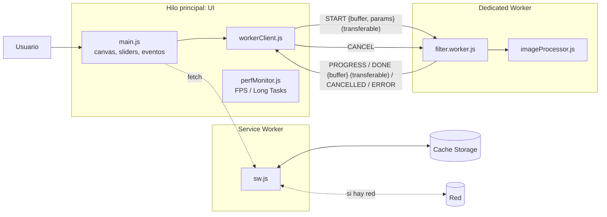

# Reporte arquitectónico — PixelForge

**Alumno:** Francisco Rafael Corzo Pérez · **Matrícula:** 233296
**Asignatura:** Programación concurrente · **Docente:** Mtro. Alí Santiago López Zunún · **Periodo:** sep-dic 2026

## 1. Problema y objetivo
Aplicar filtros (brillo, contraste, saturación, B/N, sepia y desenfoque) a fotografías de hasta 12 MP es cómputo intensivo: en el hilo principal bloquea la interfaz varios segundos. PixelForge lo resuelve en el cliente con Vanilla JS: el cálculo va a un **Dedicated Web Worker** y la app se vuelve resiliente con un **Service Worker**.

## 2. Arquitectura de hilos y comunicación

### Protocolo de mensajes
| Dirección | Mensaje | Contenido |
|---|---|---|
| Main → Worker | `start` | `buffer` (transferido), `width`, `height`, `params` |
| Main → Worker | `cancel` | — |
| Worker → Main | `started` | — |
| Worker → Main | `progress` | `percent` (0–100) |
| Worker → Main | `done` | `buffer` (transferido), `elapsedMs` |
| Worker → Main | `cancelled` / `error` | `message` |

### Flujo de un evento (pregunta de control)
1. Clic en **Aplicar filtros** → `runPipeline()` (`main.js`): valida estado, `setBusy(true)`, `perf.beginSample()`.
2. `readSourcePixels()` copia la imagen original al lienzo auxiliar y obtiene `ImageData` (RGBA).
3. `runFilterJob()` (`workerClient.js`) crea el Worker y hace `postMessage(START, [buffer])`: el buffer **se transfiere**, no se copia.
4. `filter.worker.js` recibe `onmessage` → `applyFilters()` procesa por bloques de 96 filas/columnas. Tras cada bloque, `checkpoint()` emite `PROGRESS`, revisa `cancelRequested` y cede el turno con `MessageChannel` para poder recibir `CANCEL`.
5. Al terminar, el Worker devuelve `DONE` transfiriendo el buffer. `workerClient` **destruye el Worker** (`terminate()`, listeners en `null`) y resuelve la promesa.
6. `runPipeline()` crea un `ImageData`, `putImageData` en el lienzo, muestra métricas, notifica si la pestaña está oculta y guarda el resultado en Cache Storage (`persistResult`).
7. `finally`: `state.job = null`, `setBusy(false)`.

## 3. Justificación del algoritmo
- **Filtros de color** (LUT de brillo/contraste + saturación/sepia): recorrido lineal O(n) sobre millones de píxeles.
- **Desenfoque**: *box blur* separable de 3 pasadas (aproxima un gaussiano) con ventana deslizante, O(n) independiente del radio. Con 12 MP y radio alto supera con holgura 1 s, cumple el requisito de cómputo pesado y se divide de forma natural en bloques que permiten progreso y cancelación cooperativa.
- El procesador es **puro** (sin DOM): el mismo código corre en el Worker y en el hilo principal, lo que permite comparar ambos modos con exactamente el mismo algoritmo.

## 4. Service Worker: estrategias y justificación
| Estrategia | Recurso | Por qué |
|---|---|---|
| **Cache First** | App shell precacheado (HTML, CSS, JS, iconos) | Es inmutable por versión; carga instantánea y offline garantizado. |
| **Network First** (timeout 3 s) | Navegación | Prioriza HTML fresco; si falla o hay *lie-fi*, cae a caché/`index.html`. |
| **Stale-While-Revalidate** | Otros recursos del mismo origen | Responde rápido y actualiza en segundo plano. |
| **Intercepción de recursos** | `/results/last` | El resultado calculado se guarda en Cache Storage y el SW lo sirve como si fuera un recurso de red (`X-Served-By: service-worker`). |
| Extras | Web Share Target, notificaciones | Recibir fotos desde "Compartir" y avisar al terminar un cálculo si la pestaña está oculta. |

Cumple el requisito de **al menos dos ventajas** (caché dinámica/offline-first + intercepción de recursos).

## 5. Optimización con Transferable Objects (puntos extra)
El `ArrayBuffer` de píxeles (~48 MB en 12 MP) viaja Main → Worker → Main por **transferencia** (`postMessage(msg, [buffer])`), sin clonado estructurado: la latencia de envío es prácticamente nula y no se duplica memoria.

## 6. Gestión de recursos y resiliencia
- Un Worker por trabajo, destruido en `finally` (éxito, error o cancelación) y al `pagehide`.
- Cancelación cooperativa con red de seguridad (`terminate()` tras 1.5 s sin respuesta).
- `ImageBitmap.close()` al reemplazar imágenes y `URL.revokeObjectURL` tras exportar.
- Límite de 24 MP para proteger la memoria; errores del Worker capturados y mostrados en la bitácora.
- Sin librerías, bundlers ni frameworks.

## 7. Perfilado de rendimiento (evidencia)
Procedimiento en Chrome DevTools → **Performance**:
1. Imagen de prueba 12 MP, desenfoque 20. Pulsa *Record*, aplica el filtro, detén la grabación.
2. Repite en modo **Web Worker** y en modo **Hilo principal**.
3. Captura la pista *Main* (tareas largas en rojo), *Frames* y *Long Tasks*.

| Métrica (panel de la app) | Con Worker | Sin Worker |
|---|---|---|
| Tiempo de cálculo | _completar_ | _completar_ |
| FPS mínimo | _completar_ | _completar_ |
| Long Tasks (cantidad / ms) | _completar_ | _completar_ |
| UI interactiva durante el cálculo | Sí | No |

_[Insertar captura 1: Performance con Worker]_
_[Insertar captura 2: Performance sin Worker]_
_[Interpretación: con Worker, la pista Main no muestra tareas largas asociadas al filtro y el punto animado nunca se detiene; sin Worker aparece una tarea de varios segundos que congela el lienzo.]_

## 8. UX y funcionalidad
Barra de progreso con %, botón **Cancelar**, indicadores de FPS/Long Tasks/red/SW, estados de error en la bitácora, exportación a WebP/JPEG/PNG, arrastrar y soltar, instalación como PWA y funcionamiento sin conexión.

## 9. Conclusiones
_[Escribe 3–4 líneas con tus resultados medidos y lo aprendido.]_
